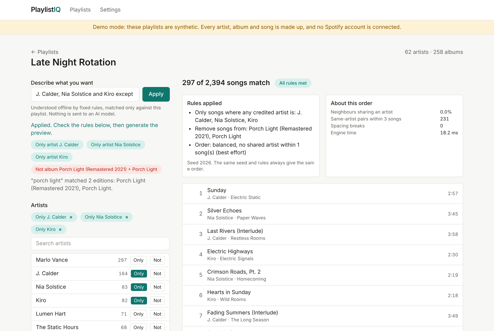

# PlaylistIQ

Pick exactly which songs from a big playlist you want to hear, and choose how they are ordered.

> "Only Marlo Vance." · "J. Calder from The Long Season." · "Marlo Vance and J. Calder except
> Overlook, no same artist back to back."

PlaylistIQ searches **inside one playlist**, keeps only the songs that match your rules, and puts
them in an order you control: truly random, *balanced* so the same artist never plays too close
together, or newest additions first. You see the exact order before anything is saved, and the
original playlist is never changed.

It is not a music player, it does not replace Spotify's shuffle, and it never invents songs: every
name is matched against the playlist itself.



**Status:** demo mode works end to end with a synthetic 2,394-song playlist. Live Spotify sign-in
and export are the next milestone and are waiting on a registered Spotify app (see
[docs/spotify-compatibility.md](docs/spotify-compatibility.md)).

## Quick start (demo mode)

Needs Python 3.12+, [uv](https://docs.astral.sh/uv/), and Node.js 22.

```bash
# API on http://127.0.0.1:8000
cd backend
uv sync
uv run uvicorn app.main:app --host 127.0.0.1 --port 8000
```

```bash
# Web app on http://127.0.0.1:3000 (second terminal)
cd frontend
npm ci
npm run dev
```

Open <http://127.0.0.1:3000> and click **Try the demo**. No Spotify account, keys, database, or
network access is needed. Interactive API docs are at <http://127.0.0.1:8000/docs>.

## What works today

- **Filters**: include or exclude any mix of artists and albums. A collaboration matches every
  credited artist (or only the main one, if you choose). Duplicates in the playlist stay as
  separate entries.
- **True random**: Fisher-Yates over entries, so every order is equally likely.
- **Balanced**: keeps the same artist at least *k* songs apart. When that is impossible it says so
  (strict mode) or gives the closest order and lists every break (relaxed mode). It never claims
  zero breaks when there are some.
- **Recently added**: newest additions first, shuffled within 30-day bands.
- **Seeds**: the same seed and rules always produce the same order, so a result can be shared.
- **Typed requests**: an offline, rule-based parser turns text into rules. It asks when a name is
  ambiguous ("Echo" is two different artists in the demo), lists names it cannot find, and
  explains requests it cannot do (play counts, moods, release years, playback control).
- **Preview**: match count, the rules in plain words, notes on feasibility, order quality metrics
  and engine timing.

## Measured results

All numbers come from running the code (13 Nov 2026, Linux x86_64 cloud VM, Python 3.13).

**Tests:** 113 backend tests (pytest), 6 component tests (Vitest + Testing Library), 5 browser
end-to-end tests (Playwright). All pass.

**Query parser** ([benchmarks/query_eval.py](benchmarks/query_eval.py)):

| Set | Queries | Exact parse | Selection precision | Selection recall |
|---|---:|---:|---:|---:|
| Development set | 132 | 100% (90.9% before tuning) | 100% | 100% |
| Held-out set | 30 | 100% (80.0% before tuning) | 100% | 100% |

Honest caveats: both sets were written by the same author as the parser, and the parser was then
tuned on the failures of both, so the "after" numbers are not an independent estimate. The
"before tuning" numbers are the closer guide to how it does on new phrasing.

**Shuffle engine** ([docs/benchmarks.md](docs/benchmarks.md), engine time only):

| Entries | True random | Balanced, gap 3 (spread artists) | Balanced, gap 3, strict (15% collaborations) |
|---:|---:|---:|---:|
| 2,000 | 0.6 ms | 16 ms | 54 ms |
| 10,000 | 3.4 ms | 164 ms | 529 ms |

Balanced mode cut neighbouring same-artist pairs from 0.8–16% of pairs (random) to 0% in every
feasible case. Over 10,000 seeds, a dominant artist's mean position was 0.50 under random and 0.49 under
balanced gap 1.

## Commands

| What | Command |
|---|---|
| Backend tests | `cd backend && uv run pytest` |
| Backend lint, format, types | `uv run ruff check app tests ../benchmarks ../scripts && uv run ruff format --check app tests ../benchmarks ../scripts && uv run mypy` |
| Parser accuracy | `cd backend && uv run python ../benchmarks/query_eval.py --show-failures` (add `--holdout` for the held-out set) |
| Shuffle benchmarks | `cd backend && uv run python ../benchmarks/shuffle_bench.py --out ../docs/benchmarks.md` (about 2 minutes; `--quick` for a short run) |
| Frontend unit tests | `cd frontend && npm test` |
| Frontend lint and types | `npm run lint && npm run typecheck` |
| End-to-end tests | `cd frontend && npx playwright install chromium && npx playwright test` (starts both servers) |
| Regenerate demo data | `python3 scripts/generate_sample_data.py` |
| Local Postgres (for live mode, later) | `docker compose up -d db` |

CI runs all of these on every push and pull request (`.github/workflows/ci.yml`).

## Configuration

Copy `.env.example` to `backend/.env`. Every value is optional; with none set the app runs in
demo mode.

| Variable | Used for |
|---|---|
| `PLAYLISTIQ_SPOTIFY_CLIENT_ID` | Live Spotify mode (PKCE, so no client secret) |
| `PLAYLISTIQ_SPOTIFY_REDIRECT_URI` | Must exactly match the Spotify app. Use `127.0.0.1`, not `localhost`. |
| `PLAYLISTIQ_SESSION_SECRET` | Signing session cookies in live mode |
| `PLAYLISTIQ_DATABASE_URL` | Postgres cache for live mode |
| `PLAYLISTIQ_CORS_ORIGINS`, `PLAYLISTIQ_FRONTEND_URL` | Allowed browser origins |
| `PLAYLISTIQ_API_URL` (frontend) | Where Next.js proxies `/api` calls |

## How it is built

- **Frontend:** Next.js (App Router), TypeScript, Tailwind CSS.
- **Backend:** Python, FastAPI, Pydantic v2. Filtering, ordering and parsing are pure functions in
  `backend/app/engine/`.
- **Spotify client:** async httpx with pagination, `Retry-After`, quota and token-refresh handling,
  tested offline with respx.

See [docs/architecture.md](docs/architecture.md) for the algorithms and their trade-offs.

```
backend/      FastAPI app, engines, Spotify client, tests
frontend/     Next.js app, components, unit and e2e tests
benchmarks/   query labels, parser evaluation, shuffle benchmarks
sample_data/  synthetic demo playlists (fictional artists and songs)
scripts/      demo data generator
docs/         architecture, Spotify compatibility, benchmarks, screenshots, demo script
```

## Limitations

- **Live Spotify mode is not built yet.** Sign-in routes, the Postgres cache and export are the
  next milestone.
- Spotify's Development Mode allows only **5 allowlisted users**, requires the app owner to have
  **Premium**, and only lets the app read songs from playlists the user **owns or collaborates on**.
  A public deployment will therefore be demo-only for most visitors.
- Spotify no longer exposes track popularity, and never exposed play counts, so "most played" and
  "deep cuts" are not possible. The app says so instead of approximating.
- Exported playlists keep their order only if Spotify's own shuffle is off while playing.
- The typed-request parser handles the phrasings in its test sets well; unusual wording can still
  be misread, which is why the rules it built are always shown before anything runs.
- Balanced mode's exhaustive search only runs for 60 entries or fewer. On larger inputs a strict
  request that the heuristics cannot solve returns "no valid order found", which is not a proof
  that none exists.

## Data and privacy

The demo data is generated by `scripts/generate_sample_data.py`: every artist, album and song is
fictional, and nothing comes from Spotify. Playlist data is never sent to an AI model or any
third party. In live mode, tokens stay on the server and cached playlists are deleted on
disconnect.
